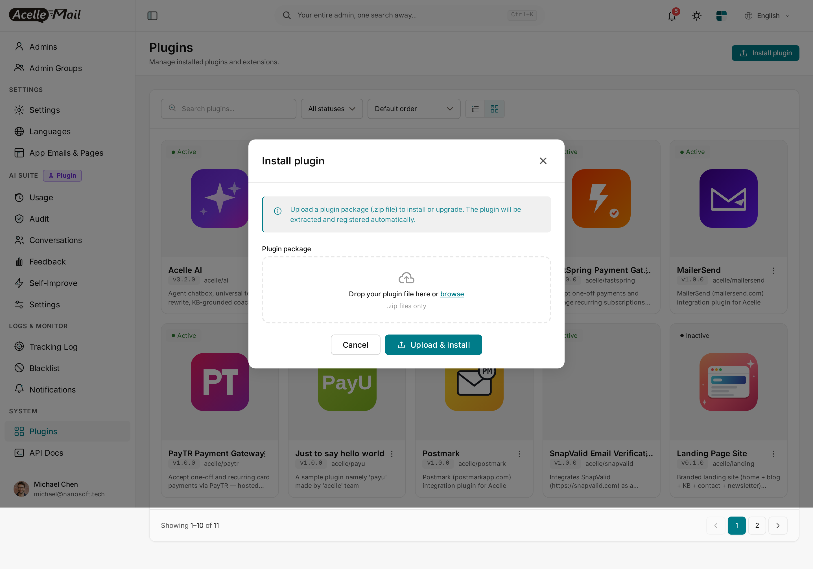
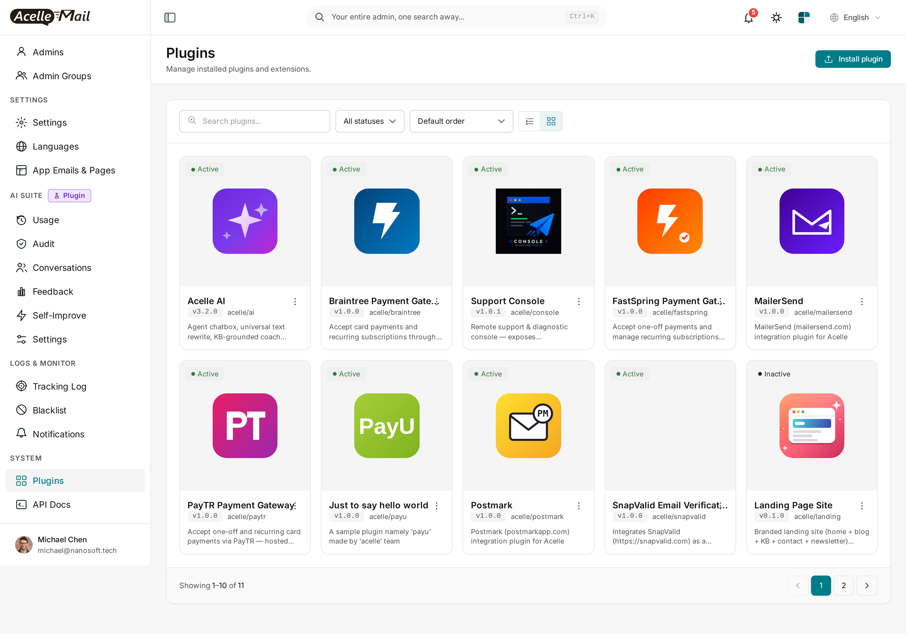
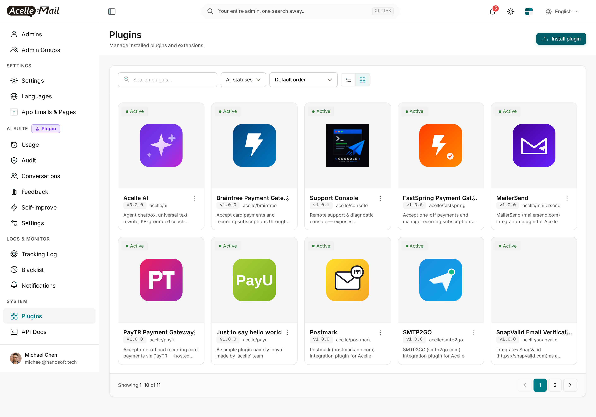
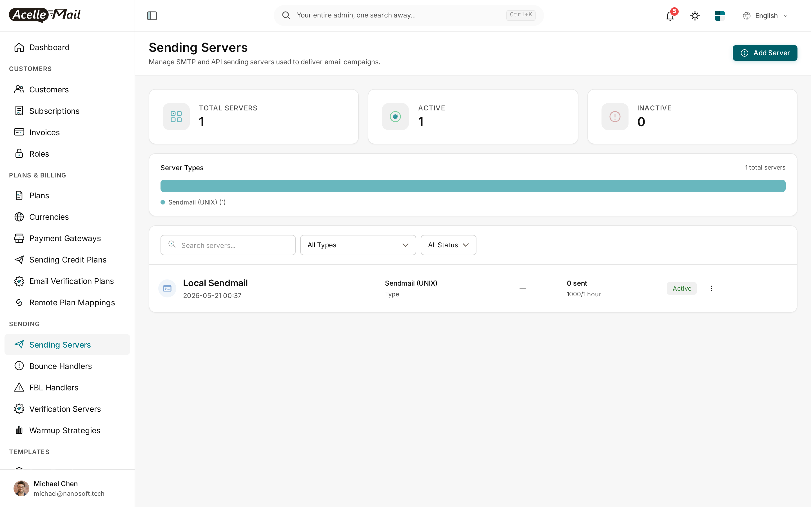
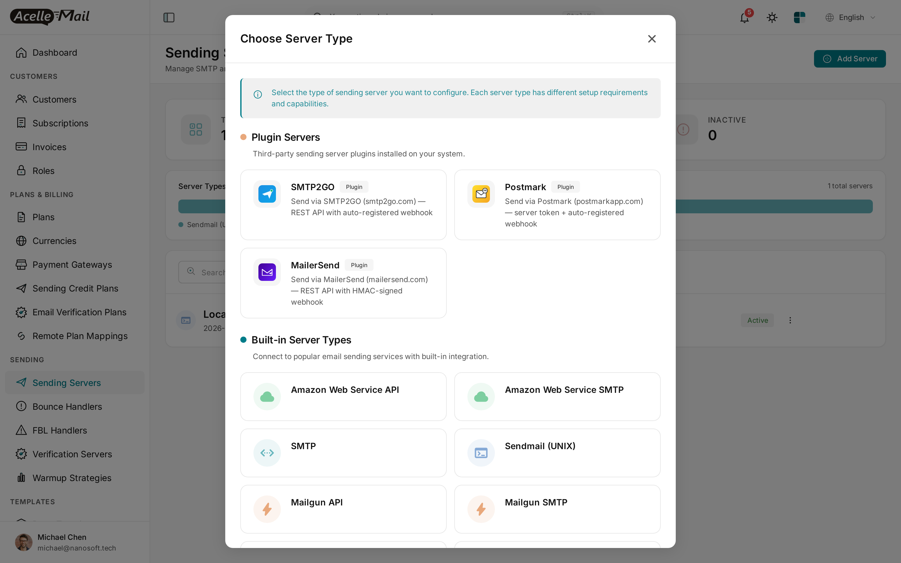
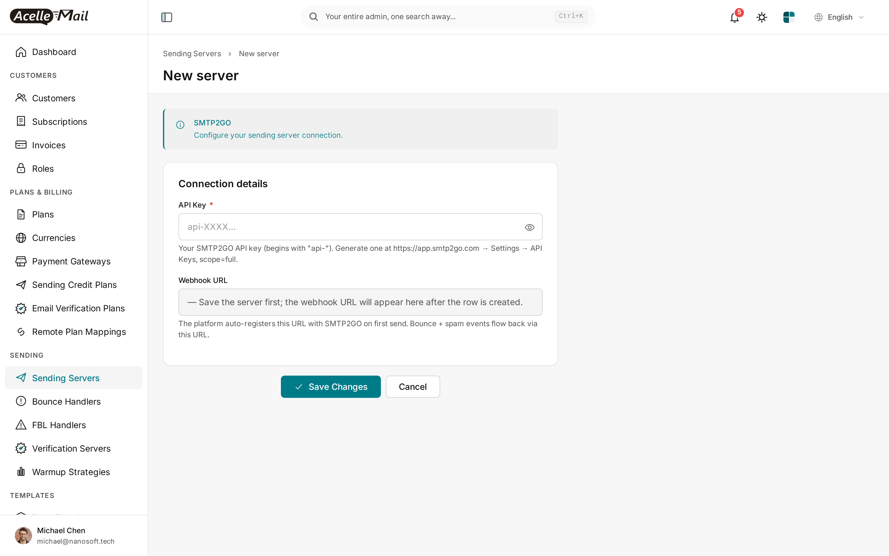
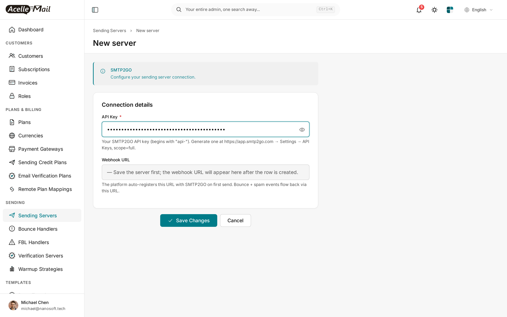

# SMTP2GO for Acelle Mail — User Guide

A drop-in plugin that adds **SMTP2GO** (`smtp2go.com`) as a sending-server type in Acelle. SMTP2GO is a global SMTP relay + REST API specialising in deliverability — they handle DKIM signing, IP warmup, and the boring deliverability infrastructure on every email. This plugin sends via SMTP2GO's REST API and **auto-registers the bounce / spam webhook on first send** so you never have to copy-paste a webhook URL between two dashboards.

---

## Table of Contents

1. [Requirements](#1-requirements)
2. [Install the plugin](#2-install-the-plugin)
3. [Enable the plugin](#3-enable-the-plugin)
4. [Add SMTP2GO as a sending server](#4-add-smtp2go-as-a-sending-server)
5. [Configure the API key](#5-configure-the-api-key)
6. [Auto-registered webhook — how it works](#6-auto-registered-webhook-how-it-works)
7. [Sending identities (verified domains)](#7-sending-identities-verified-domains)
8. [Test the connection](#8-test-the-connection)
9. [Assign the server to a plan or customer](#9-assign-the-server-to-a-plan-or-customer)
10. [Troubleshooting](#10-troubleshooting)
11. [Uninstall](#11-uninstall)

---

## 1. Requirements

| | Minimum |
|---|---|
| **Acelle Mail** | 4.2.0 or newer |
| **PHP** | 8.1+ |
| **SMTP2GO account** | Free signup at [smtp2go.com](https://smtp2go.com). Free plan: 1000 emails/month forever, no card required. |
| **API key** | Generated at app.smtp2go.com → Settings → API Keys (`api-...` prefix). Scope = **full**. |
| **Outbound HTTPS** | Server must reach `api.smtp2go.com` on port 443 |
| **Inbound HTTPS** | Your Acelle install must be reachable so SMTP2GO can POST bounce / spam webhooks to `https://your-acelle-domain/webhook/acelle-smtp2go/{server_uid}` (URL is auto-registered) |

---

## 2. Install the plugin

1. Download the plugin ZIP from your account's **Plugins** page.
2. **System → Plugins** → **Install plugin** → drop ZIP → **Upload & install**.

After install, **SMTP2GO** appears as **Inactive**:

---

## 3. Enable the plugin

Find the **SMTP2GO** card → ⋮ → **Enable**.

Card flips to **Active**:

---

## 4. Add SMTP2GO as a sending server

1. **Sending → Sending Servers** → **+ Add Server**.

2. Picker opens. Pick **SMTP2GO** from the **Plugin Servers** group:

---

## 5. Configure the API key

Only one field to fill: the API key.

| Field | Value |
|---|---|
| **Name** | Label for your sending-server list (e.g. `SMTP2GO (production)`) |
| **API Key** | From app.smtp2go.com → Settings → API Keys. Begins with `api-`. Must have **full scope** so the plugin can send emails AND auto-register the webhook. |
| **Webhook URL** | *Read-only.* Populated after the row is saved + first send. |

Click **Save**. The plugin verifies the API key with a live probe — wrong key, inline 401 error, row not saved.

---

## 6. Auto-registered webhook — how it works

The first time a campaign / automation / transactional email is sent through this SMTP2GO server, the plugin's `setupBeforeSend` hook fires and calls SMTP2GO's `POST /webhook/add` endpoint:

1. Plugin generates a random **webhook user + password** (basic-auth pair).
2. Plugin calls `POST /webhook/add` with:
    - `url`: `https://your-acelle-domain/webhook/acelle-smtp2go/{server_uid}`
    - `events`: `bounce`, `spam`, `unsubscribe` (configurable).
    - `username` + `password` (the basic-auth pair).
3. SMTP2GO returns a webhook id. Plugin stores `smtp2go_webhook_id`, `smtp2go_webhook_user`, `smtp2go_webhook_pass` in the server config.
4. From then on, every status event SMTP2GO emits is POSTed to your Acelle URL with **HTTP Basic Auth**. The plugin verifies the user / pass on every callback. Spoofed POSTs are rejected at the edge.

You never paste anything into SMTP2GO's dashboard — the registration is fully automatic.

> **Force the webhook to register before first real send.** Use **⋮ → Test send** on the Sending Servers list. The single test email triggers `setupBeforeSend` exactly like a real send would.

---

## 7. Sending identities (verified domains)

SMTP2GO uses domain-level sender verification — you verify your sending domain at app.smtp2go.com → **Sender Domains**. Once verified, you can send from any address on that domain.

The plugin syncs SMTP2GO domains into Acelle's `sending_identities` table:

- **Sync from SMTP2GO** — `GET /domain/show` reconciles your SMTP2GO domain list into Acelle.
- **DKIM + DMARC records** for each domain are surfaced inside Acelle's identity detail page (copy-paste DNS lines).

> **Without a verified sending domain**, SMTP2GO silently drops sends from unverified addresses. **Verify your domain BEFORE flipping production traffic to SMTP2GO.**

---

## 8. Test the connection

Two ways to verify before wiring the server into a real plan:

**(a) Connection test** — built into the new-server form. The Save handler runs a live `/account` probe against the API key.

**(b) Test send** — from the Sending Servers list, ⋮ → **Test send**. Acelle delivers a single test email through the driver and reports the vendor `message_id`. **The first test send also triggers webhook auto-registration** — see [§6](#6-auto-registered-webhook-how-it-works).

---

## 9. Assign the server to a plan or customer

| Model | When to use |
|---|---|
| **System server, plan-attached** | Your Acelle SaaS sends on behalf of customers. Assign SMTP2GO at **Admin → Plans → \[plan\] → Sending Servers**. |
| **Per-customer** | A specific customer brings their own SMTP2GO account. They add the server from their own customer-side **Sending Servers** page. |

---

## 10. Troubleshooting

| Symptom | Likely cause | Fix |
|---|---|---|
| "401 Unauthorized" on save | API key wrong, scope not "full" | Re-generate at app.smtp2go.com → Settings → API Keys with scope=full |
| Sends succeed, no bounces appear | Webhook not yet auto-registered (no real send through this server yet) | Use ⋮ → Test send to force webhook auto-registration |
| Webhooks land but rejected as unauthorized | Basic-auth user/pass in `sending_servers.config` doesn't match what SMTP2GO has on file | Edit the server, blank the API key field and re-paste; this triggers fresh webhook registration |
| Email accepted by API but never delivered | Sending domain not verified at SMTP2GO | Verify domain at app.smtp2go.com → Sender Domains |
| Plugin Active but SMTP2GO missing from picker | Stale opcache / view cache | `php artisan optimize:clear` and reload |

Plugin HTTP calls log to `storage/logs/laravel.log`.

---

## 11. Uninstall

1. **System → Plugins** → find **SMTP2GO** → ⋮ → **Disable**. New sending servers can no longer be created with this driver; existing rows still work.
2. To remove files: ⋮ → **Delete**. **Drops every `sending_servers` row of type `acelle-smtp2go`** (handled by the plugin's lifecycle hook).

You may also want to disable the webhook in SMTP2GO's dashboard manually; otherwise it'll keep POSTing to a now-404 URL until SMTP2GO's retry policy gives up.

---

## Support

- Documentation: this guide + plugin source code comments
- Questions & issues: contact **support@acellemail.com**

SMTP2GO account / billing / domain-verification issues go to SMTP2GO support directly.
